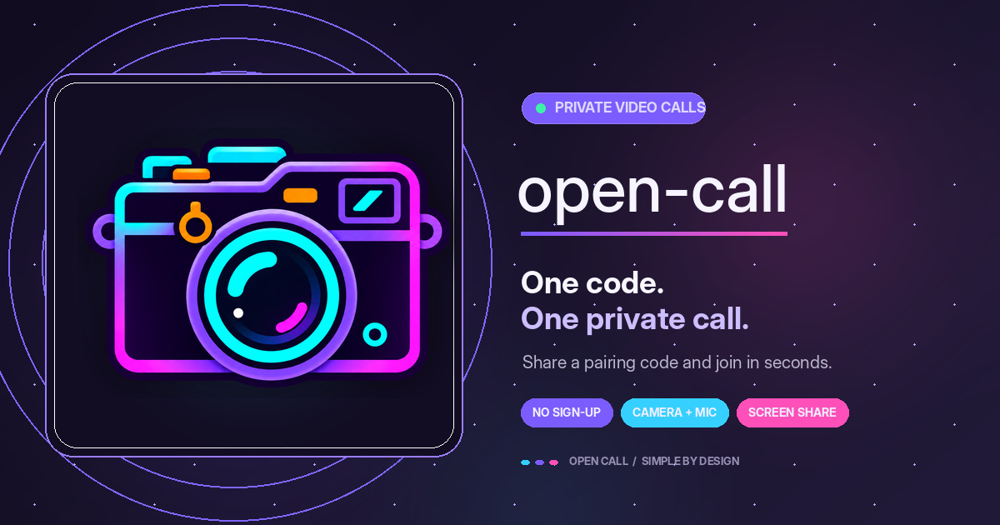

<div align="center">
  
  <h1>Open Call</h1>
  <p><strong>Self-hostable, room-code video calls — without accounts or a meeting SDK.</strong></p>
  <p>
    <a href="https://github.com/blurry-eyez/open-call/actions/workflows/ci.yml"></a>
    <a href="LICENSE"></a>
    
    
  </p>
  <p><a href="https://call.2105s.xyz">Live demo</a> · <a href="docs/SETUP.md">Setup guide</a> · <a href="docs/DEPLOYMENT.md">Deployment guide</a> · <a href="docs/ARCHITECTURE.md">Architecture</a></p>
</div>

Open Call is a small, self-hostable video calling application. Participants enter the same pairing code, allow camera and microphone access, and join the same room. There is no account system or third-party meeting UI SDK.

The project is intentionally split between a lightweight Python signaling server and Cloudflare Realtime SFU for media forwarding. You run the application server and control its room state, configuration, recordings, and deployment. Cloudflare provides the SFU transport and optional TURN relay service.

> **Important:** Open Call is a starting point for your own application, not a fully audited conferencing service. Read [Security and privacy](SECURITY.md) before exposing an instance to the public internet.

## Features

- Pairing-code rooms with display names; no sign-up flow.
- Multi-participant audio and video, with a configurable room limit (8 by default).
- Join approval / waiting room, and the ability to lock a room.
- Screen sharing, including optional shared system or tab audio where the browser supports it.
- Video quality selection and automatic quality adaptation.
- Camera, microphone, speaker, and device selection controls.
- Browser-side composite call recording, uploaded in chunks to the server.
- Reconnect grace period, basic join rate limiting, and a health endpoint.
- Responsive single-page interface and installable web-app assets.

## How it works

```text
Participant browser
  ├── HTTPS / WebSocket signaling ──> Open Call (Python + aiohttp)
  │                                    ├── room membership / waiting room
  │                                    ├── SFU session API calls
  │                                    └── recording upload + SQLite index
  │
  └── WebRTC media ─────────────────> Cloudflare Realtime SFU
                                       └── forwards published tracks to peers
```

The Python server does **not** relay the live audio/video stream. It coordinates rooms and talks to the Cloudflare SFU using server-side credentials. Browsers publish and subscribe to media through the SFU. Optional TURN credentials help participants connect from restrictive networks.

Call recordings are different: the browser builds a combined canvas/audio recording and uploads it to the Open Call server. Those files are stored on the host in `recordings/` and indexed in `database.db`.

See [Architecture](docs/ARCHITECTURE.md) for the request flow and current limitations.

## Quick start

### 1. Requirements

- Python 3.10 or newer.
- A Cloudflare account with a Realtime SFU application.
- A modern browser with camera and microphone access.
- HTTPS for access from phones and other non-localhost devices. Browsers generally allow media permissions on `localhost` during development.

### 2. Get the code

```bash
git clone https://github.com/blurry-eyez/open-call.git
cd open-call
```

Replace `` with the GitHub account or organization that publishes your fork.

### 3. Configure Cloudflare

Create a Realtime SFU application in the Cloudflare dashboard under **Realtime → Serverless SFU**. Copy its App ID and App Secret. Keep the App Secret on the server; never put it in `static/` or frontend JavaScript.

Copy the example environment file and add the required values:

```bash
cp .env.example .env
chmod 600 .env
nano .env
```

Set at least:

```dotenv
CF_REALTIME_APP_ID=your_sfu_app_id
CF_REALTIME_APP_SECRET=your_sfu_app_secret
```

TURN is strongly recommended for users behind restrictive NATs or firewalls. Create a Cloudflare Realtime TURN key, then set `CF_TURN_KEY_ID` and `CF_TURN_API_TOKEN`. See the [Cloudflare setup guide](docs/CLOUDFLARE_SETUP.md) for the complete steps.

### 4. Start the server

```bash
chmod +x run.sh
./run.sh
```

The first run creates `.venv`, installs `requirements.txt`, and starts the app. Open <http://127.0.0.1:9876> on the same machine.

Check server health:

```bash
curl http://127.0.0.1:9876/health
```

A healthy response includes `"ok": true`. For calls to work, `"sfu"` must also be `true`. `"turn"` is `true` when TURN credentials are configured and available.

## Production deployment

Do not expose the Python development server directly to the internet. Put it behind a TLS reverse proxy or a securely configured Cloudflare Tunnel, keep the app bound to `127.0.0.1`, and set `PUBLIC_URL` to the public HTTPS URL. WebSockets must be passed through by the proxy.

The [deployment guide](docs/DEPLOYMENT.md) includes a Caddy example, a systemd service example, firewall notes, backups, and a launch checklist.

## Configuration

All settings are read from `.env` or the process environment at startup.

| Variable | Required | Default | Purpose |
|---|---:|---:|---|
| `CF_REALTIME_APP_ID` | Yes | — | Cloudflare Realtime SFU application ID |
| `CF_REALTIME_APP_SECRET` | Yes | — | SFU bearer secret; server-side only |
| `CF_TURN_KEY_ID` | Recommended | — | Cloudflare TURN key ID |
| `CF_TURN_API_TOKEN` | Recommended | — | Server-side token used to mint short-lived TURN credentials |
| `HOST` | No | `127.0.0.1` | Listen address; keep loopback behind a local proxy |
| `PORT` | No | `9876` | HTTP/WebSocket port |
| `PUBLIC_URL` | No | Request origin | Canonical public origin, e.g. `https://call.example.com` |
| `MAX_PEERS` | No | `8` | Maximum simultaneous participants per room |
| `RECONNECT_GRACE_SECONDS` | No | `12` | How long a disconnected participant can resume |
| `MAX_RECORDING_MB` | No | `4096` | Maximum size of one recording upload |
| `JOINS_PER_MINUTE` | No | `40` | Join attempts allowed per IP per rolling minute (per process) |
| `KNOCK_SECONDS` | No | `120` | Time a newcomer can wait for admission |

More detail and operational notes: [Configuration reference](docs/SETUP.md#configuration-reference).

## Runtime data

The app creates these paths next to `server.py`:

| Path | Contents | Persistent? |
|---|---|---|
| `database.db` | SQLite recording index | Yes; back it up |
| `recordings/` | Uploaded call recordings | Yes; back it up or define a deletion policy |
| `logs/server.log` | Rotating application log | Yes; rotate/retain according to your policy |
| `.venv/` | Python environment | Re-creatable |

These paths are ignored by Git. They can contain personal data and must not be committed.

## Documentation

- [Setup and configuration](docs/SETUP.md)
- [Cloudflare Realtime credentials](docs/CLOUDFLARE_SETUP.md)
- [Production deployment](docs/DEPLOYMENT.md)
- [Architecture and request flow](docs/ARCHITECTURE.md)
- [Troubleshooting](docs/TROUBLESHOOTING.md)
- [Security and privacy notes](SECURITY.md)
- [Contributing](CONTRIBUTING.md)

## Contributing

Issues and pull requests are welcome. Before opening a PR, run:

```bash
python -m pip install -r requirements.txt
python -m unittest discover -s tests -v
python -m py_compile server.py
```

See [CONTRIBUTING.md](CONTRIBUTING.md) for scope and review expectations.

## License

Released under the [MIT License](LICENSE). Review the license before reusing the project or its bundled visual assets in a product.

---

**Built to be forked, self-hosted, inspected, and changed.**
