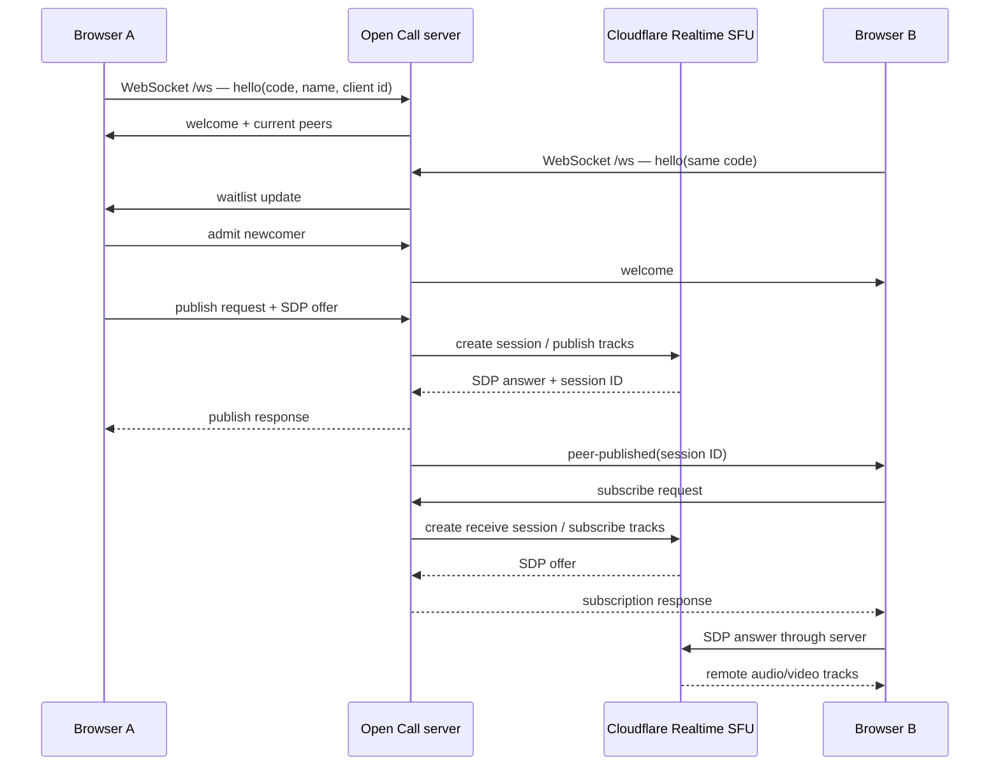

# Architecture

Open Call is a single-process Python application with a static browser client. It does not bundle a separate JavaScript build system.

## Components

| Component | Responsibility |
|---|---|
| `server.py` | HTTP routes, WebSocket signaling, room state, Cloudflare API calls, recording endpoints, SQLite index, logs |
| `static/index.html` | Lobby, call UI, media capture, WebRTC peer connections, quality controls, screen sharing, browser-side recording |
| Cloudflare Realtime SFU | Receives browser publications and forwards tracks to selected subscribers |
| Cloudflare Realtime TURN | Optional relay service for difficult NAT/firewall paths |
| `database.db` | Recording metadata index |
| `recordings/` | Video files uploaded by the browser recorder |

## Call connection flow

The live media path is browser-to-SFU. The Python server coordinates room membership and makes authenticated SFU API calls; it does not proxy the live media packets.

## Signaling protocol

The browser opens one WebSocket at `/ws`. It sends a `hello` message containing a room code, display name, and browser client identifier. The server holds active room and peer state in Python memory.

The principal request types are:

- `publish`: create an SFU session for local camera/microphone or screen-share tracks.
- `subscribe`: create a receive-side SFU session for another participant's publication.
- `renegotiate`: submit an SDP answer for a session owned by that peer.
- `state`: update microphone, camera, and recording indicators.
- `admit`: allow or deny a waiting participant.
- `lock`: prevent new participants from joining the room.
- `screen-stop`, `ping`, and `leave`: screen-share lifecycle, keepalive, and departure.

The browser uses a publisher connection and separate subscriber connections for remote participants. The server's current implementation uses non-trickle ICE gathering before sending SDP to the SFU.

## Recording flow

1. A participant starts recording in the advanced settings panel.
2. The browser draws the visible remote participant tiles into a canvas and mixes available audio tracks.
3. The browser's `MediaRecorder` produces chunks.
4. Chunks are sent to `/api/rec/{id}/chunk` and appended to a file under `recordings/`.
5. A SQLite row in `database.db` stores the recording ID, room code, display name, MIME type, timestamps, size, and chunk count.
6. The UI lists available recordings while the participant is still present in the room. Download uses `/rec/{id}`.

This is a browser-side composite recording, not a server-side recording of the raw SFU streams. Browser support and the media available to the recorder affect the resulting file.

## State and scaling

Room membership, peer state, waiting lists, join-rate counters, and TURN credential cache are process memory. The SQLite database persists recording metadata, and recording files persist on disk.

Consequences:

- Run one Open Call process for one deployment instance.
- A process restart drops active rooms and WebSocket sessions.
- The current design is not horizontally scalable: multiple workers/instances would not share room state.
- A reconnect can resume the same browser client during the grace period (12 seconds by default).
- The join rate limiter is per process and is not a distributed abuse-control system.

## HTTP routes

| Route | Method | Purpose |
|---|---|---|
| `/` | GET | Serves the single-page app with public-origin metadata |
| `/ws` | GET / WebSocket | Room signaling |
| `/health` | GET | Basic process and configuration health |
| `/api/ice` | GET | STUN and optional temporary TURN ICE server configuration |
| `/api/rec/start` | POST | Create a recording record for an active participant |
| `/api/rec/{id}/chunk` | POST | Append a recording chunk |
| `/api/rec/{id}/stop` | POST | Mark a recording finished |
| `/api/recordings` | GET | List recordings for a participant currently in the room |
| `/rec/{id}` | GET | Download a recording by its ID |
| `/robots.txt`, `/sitemap.xml`, `/favicon.ico`, `/static/*` | GET | Public site assets and crawler metadata |

## Security boundaries

The SFU App Secret and TURN token stay in the Python process. The browser receives temporary ICE credentials but does not receive the long-lived Cloudflare secrets.

The current app has no account system. A room code is the practical join secret, with a waiting-room approval step when a room is already occupied. This is not equivalent to strong user authentication. Recording download URLs are capability-style links: anyone who obtains a valid recording ID can request that file. See [Security and privacy](../SECURITY.md) before public deployment.
